# Apex Code Reviewer

**Author:** Kudrat Arora
**Prototype 2** of my SEL703 placement at ConnectX Consulting (Junior Software Engineer, AI & Cloud Solutions)

I built this prototype using agentic AI (Anthropic Claude). It is a Claude Code plugin that reviews Salesforce Apex code for problems that break in production: database queries and saves inside loops, triggers that only handle one record, SOQL injection, hardcoded record IDs and missing security checks.

Tested rules find the exact problems with line numbers. Claude then reads the code to confirm each one, **finds problems the rules cannot see**, explains why each one matters and suggests a fix.

```
/apex-code-reviewer:review-apex force-app
```

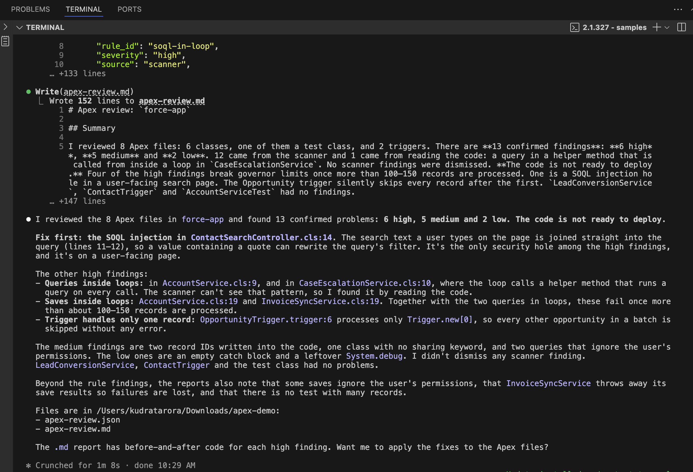

## What this prototype covers

| Requirement | Where to find it |
|---|---|
| **Working agentic AI prototype** using Anthropic Claude | [How it works](#how-it-works), [A review in Claude Code](#a-review-in-claude-code) |
| **Testing** with recorded results | [Testing](#testing): 44 unit tests, two sample projects with answer keys, evals with and without the plugin on two Claude models |
| **Technical documentation** | This README: [architecture](#how-it-works), [how the scanner reads Apex](#how-the-scanner-reads-apex), [MCP tool reference](#mcp-tool-reference), [install](#install), [troubleshooting](#troubleshooting), [adding a rule](#adding-a-rule) and [version history](#version-history). Also the rules reference in `skills/apex-review/references/rules.md` and the eval index in `evals/results/README.md` |
| **Evidence** | 34 screenshots in `evidence/screenshots/` and the output of a live review in `evidence/demo-run/` |

## Why I built it

Salesforce runs every transaction under strict governor limits. Code that works in a sandbox with a few test records can fail in production the first time a data load sends 200 records through a trigger. Reviewing code for these problems is a routine part of Salesforce delivery, and it is easy to miss one in a large change.

My first prototype used the Claude API inside a web app. For this one I wanted to try a different integration pattern: bringing an agent into the developer's own tool, Claude Code, using the Model Context Protocol (MCP), Agent Skills and plugin packaging.

## How it works

```
Claude Code
  │  /apex-code-reviewer:review-apex force-app
  ▼
apex-review skill (skills/apex-review/SKILL.md)
  │  the review method: list, scan, read, confirm, report
  │
  ├─► MCP server "apex" (dist/server.js, runs locally)
  │     list_apex_files · scan_apex_file · explain_rule
  │     9 tested rules find exact matches with line numbers
  │
  └─► Claude reads the code itself
        confirms or dismisses each finding
        finds problems the rules cannot see
        writes apex-review.md and apex-review.json
```

| Part | File | Job |
|---|---|---|
| Plugin manifest | `.claude-plugin/plugin.json` | Name, version, licence and description of the plugin |
| MCP server | `.mcp.json`, `src/server.ts` | Gives Claude three read-only tools that run on the developer's machine |
| Rules | `src/rules.ts`, `src/apex.ts` | Nine review rules with explanations and fixes |
| Skill | `skills/apex-review/SKILL.md` | The review method, severity guide and report format |
| Rules reference | `skills/apex-review/references/rules.md` | Full rule explanations, loaded only when Claude needs them. Generated from `src/rules.ts` |
| Command | `commands/review-apex.md` | The `/review-apex` shortcut |
| Marketplace | `.claude-plugin/marketplace.json` | Lets anyone install the plugin from this repository |

**Design decision:** the rules find facts and Claude makes judgements. Pattern rules are fast and exact, but they cannot follow a call from one method into another. Claude can, but on its own it may miss lines or report them inconsistently. Combining the two gives exact line numbers plus the understanding of a human reviewer.

**Privacy and safety:** the code never leaves the developer's machine, apart from what Claude Code already sends to Claude. The three MCP tools are marked read-only, non-destructive and closed to the outside world. They only open `.cls` and `.trigger` files, so they cannot be used to read anything else.

| | |
|---|---|
| 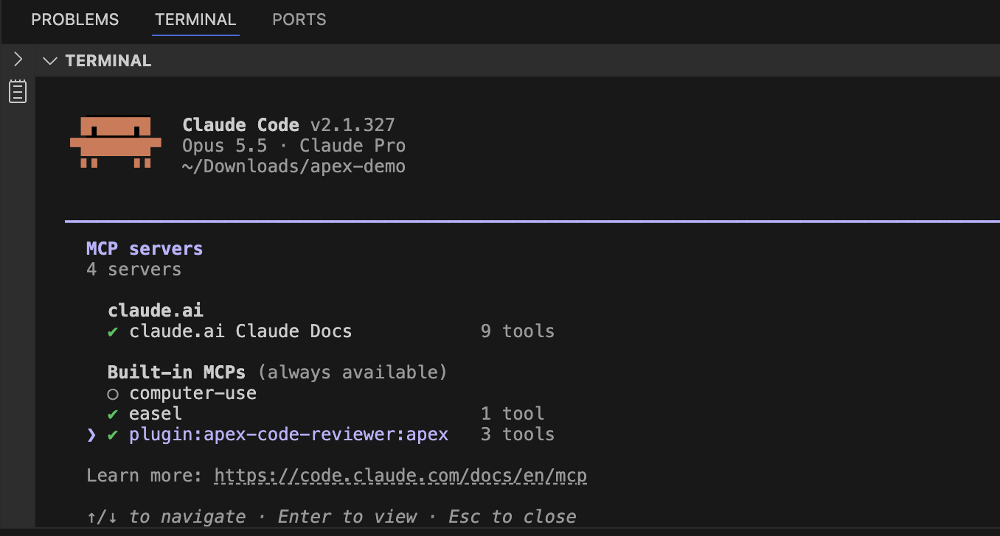 | 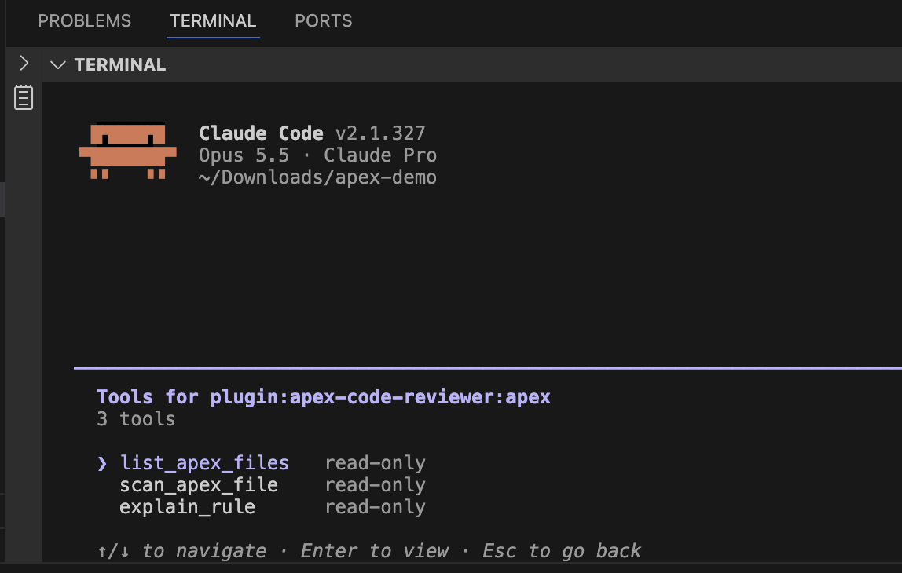 |

## The rules

| Rule ID | Severity | Problem |
|---|---|---|
| `soql-in-loop` | high | A query runs once per loop iteration and hits the 100 query limit |
| `dml-in-loop` | high | Records are saved one at a time and hit the 150 DML limit |
| `soql-injection` | high | Query text is built by joining in user input |
| `trigger-not-bulkified` | high | The trigger only processes `Trigger.new[0]` |
| `hardcoded-id` | medium | A record ID is written into the code, which breaks in another org |
| `missing-sharing` | medium | The class has no `with sharing` keyword |
| `soql-without-user-mode` | medium | A query ignores the user's permissions |
| `empty-catch` | low | An error is caught and silently ignored |
| `debug-statement` | low | `System.debug` is left in the code |

Full explanations and fixes: [skills/apex-review/references/rules.md](skills/apex-review/references/rules.md)

The scanner also works on its own, without Claude. On the sample project it finds all 12 problems that the rules cover:

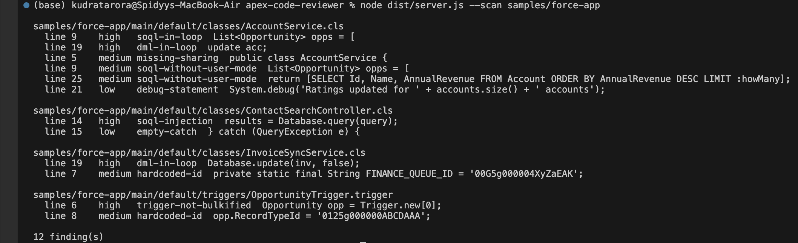

## How the scanner reads Apex

The rules do not use a full Apex compiler. `src/apex.ts` prepares each file in three steps, so that simple patterns give reliable results:

1. **Blank out comments and strings.** Comment text and the contents of string literals are replaced with spaces. Commented-out code and text such as `'update later'` can then never trigger a rule. Every character keeps its position, so line numbers stay exact. The string values are kept separately for the rules that need them, such as `hardcoded-id` and `soql-injection`.
2. **Map the loop bodies.** It walks the code and marks every character that sits inside a `for`, `while` or `do` loop, including loops without braces and loops inside loops. The loop header itself is not marked, so a SOQL for loop such as `for (Account a : [SELECT ...])` is correctly treated as safe.
3. **Note the file type.** It records whether the file is a trigger and whether it is a test class (`@isTest`). Test classes are expected to use debug statements and system-mode queries, so those rules skip them.

Each rule in `src/rules.ts` then searches the prepared code. `soql-in-loop`, for example, finds every `[SELECT ...]` or `Database.query(...)` and keeps only those inside a loop body. The scanner reports at most one finding per rule per line and sorts the findings by severity, then by line.

What this approach cannot see is a call from one method into another. That is why the skill tells Claude to read every file and look for queries and saves in helper methods that are called from a loop.

## MCP tool reference

The MCP server (`src/server.ts`) gives Claude three tools. All three are read-only, non-destructive, idempotent and closed to the outside world, and they return JSON. Paths are relative to the project folder that Claude Code is running in.

| Tool | Input | Returns |
|---|---|---|
| `list_apex_files` | `path`: a folder, or `.` for the whole project | `folder`, `count` and `files`. Each file has a `path`, a `type` (`class` or `trigger`), a `lines` count and `is_test` |
| `scan_apex_file` | `path`: one `.cls` or `.trigger` file | `path`, `is_test`, `count` and `findings`. Each finding has a `rule_id`, `severity`, `line`, `snippet` (the line of code) and `message` |
| `explain_rule` | `rule_id`: one of the nine rule IDs | The rule's `id`, `title`, `severity`, `category`, `why` and `fix` |

Example `scan_apex_file` result (shortened):

```json
{
  "path": "samples/force-app/main/default/classes/AccountService.cls",
  "is_test": false,
  "findings": [
    {
      "rule_id": "dml-in-loop",
      "severity": "high",
      "line": 19,
      "snippet": "update acc;",
      "message": "Records are saved once per loop iteration."
    }
  ],
  "count": 6
}
```

**Safety limits:**
- `scan_apex_file` only accepts `.cls` and `.trigger` files. Any other file returns an error, for example `Only .cls and .trigger files can be scanned: README.md`.
- Files larger than 1 MB are refused.
- `list_apex_files` stops at 500 files and skips `node_modules`, `.git`, `.sfdx`, `.sf`, `dist` and `.vscode`.
- An unknown rule ID returns an error that lists the valid IDs.

## A review in Claude Code

Running `/apex-code-reviewer:review-apex force-app` on the sample project:

1. Claude loads the `apex-review` skill, lists the Apex files and scans each one with the MCP tools.
2. It reads every non-test file in full and confirms or dismisses each scanner finding.
3. It writes `apex-review.md` for people and `apex-review.json` for tools.
4. It gives a short summary in chat, names the most important problem to fix first and offers to apply the fixes.

In this run Claude reviewed 8 files and confirmed **13 problems: 6 high, 5 medium and 2 low**. Twelve came from the scanner. **One came from reading the code:** a query inside a helper method that is called from inside a loop, which the rules cannot see.

| | |
|---|---|
| 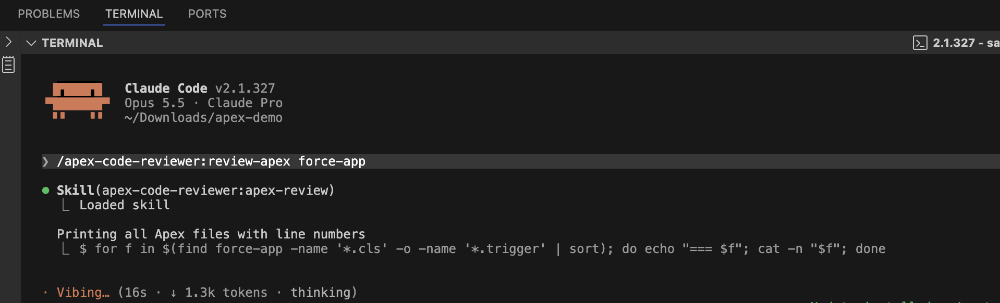 | 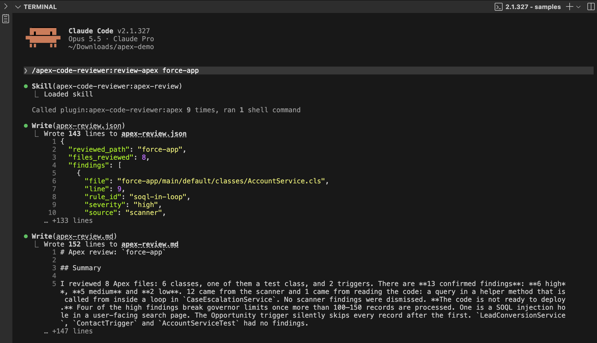 |

The report has a summary, a table of confirmed findings, a before and after code example for each high severity finding, and notes on concerns that the rules do not cover.

| | |
|---|---|
| 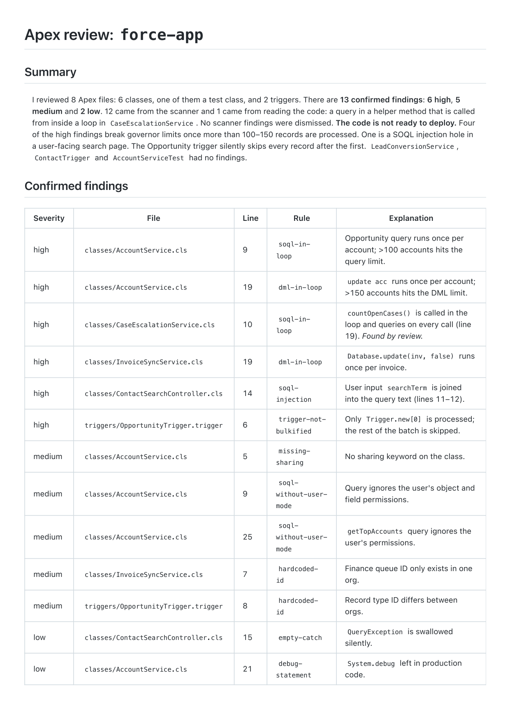 | 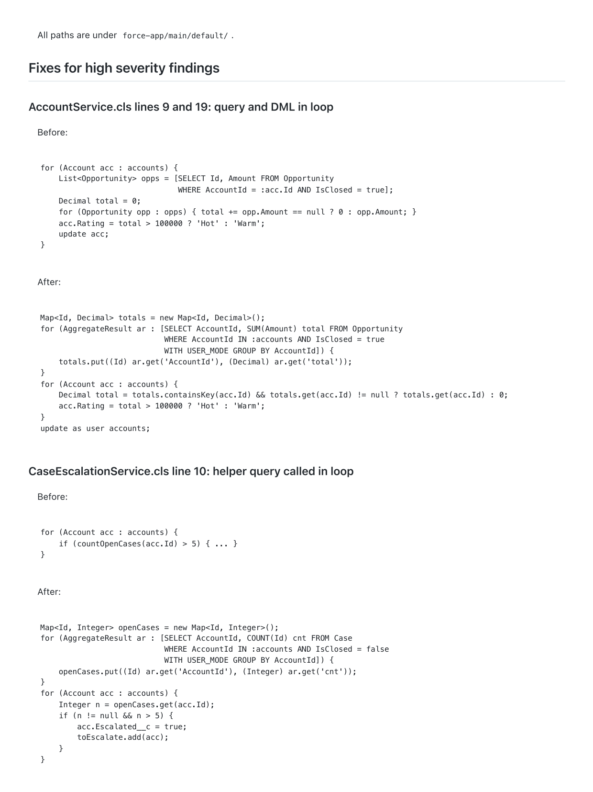 |

The full output of this run is in [evidence/demo-run/](evidence/demo-run/). Another example is in [examples/apex-review.md](examples/apex-review.md).

## Install

You need [Claude Code](https://claude.com/claude-code) and Node.js 20 or newer.

```
/plugin marketplace add KudratAroraa/apex-code-reviewer
/plugin install apex-code-reviewer@apex-code-reviewer
```

I tested this install from GitHub in a fresh Salesforce project. The plugin installed, its MCP server connected with all three tools, and a full review ran straight away.

| | |
|---|---|
| 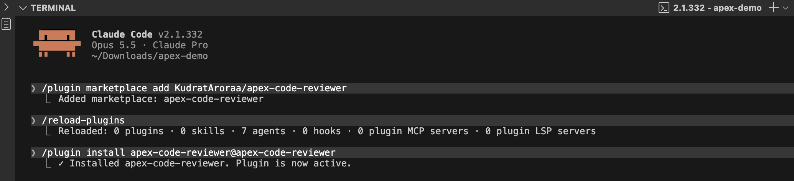 | 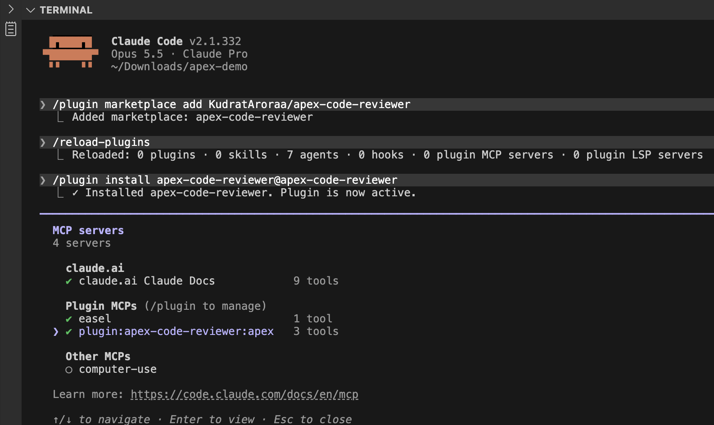 |

Then, in any Salesforce project:

```
/apex-code-reviewer:review-apex force-app
```

or just ask: *"Review the Apex in force-app for governor limit problems."*

To try it from a local copy without installing:

```bash
claude --plugin-dir /path/to/apex-code-reviewer
```

To use the scanner without Claude:

```bash
node dist/server.js --scan force-app
```

### Troubleshooting

| Problem | Cause and fix |
|---|---|
| Claude Code asks *"New MCP server found in this project: apex"* | This happens when Claude Code is started inside the plugin's own folder, because it finds the plugin's `.mcp.json`. Choose **Continue without using this MCP server**. The plugin loads its own copy of the server. To avoid the question, run Claude Code in your Salesforce project, not in the plugin folder. |
| `/mcp` does not list `plugin:apex-code-reviewer:apex` | Check that Node.js 20 or newer is installed (`node --version`). The server needs it to start. |
| `/apex-code-reviewer:review-apex` is not found | The plugin is not loaded. Run `/plugin` to check that it is installed and enabled, or start Claude Code with `--plugin-dir`. |
| Claude asks before using each tool | This is Claude Code's normal permission check. You can allow the `apex` tools for the rest of the session, because they are read-only. |
| A file is skipped | Only `.cls` and `.trigger` files under 1 MB are scanned. Other files are ignored by design. |

## Testing

### Unit tests (44 passing)

```bash
npm install
npm test
```

| File | What it tests |
|---|---|
| `tests/rules.test.ts` | Every rule on good and bad examples, including the tricky cases: queries in comments and strings, SOQL for loops, loops without braces, inner classes, test classes and line numbers after block comments |
| `tests/samples.test.ts` | The scanner against the answer keys for both sample projects, and that the tools refuse to read non-Apex files |

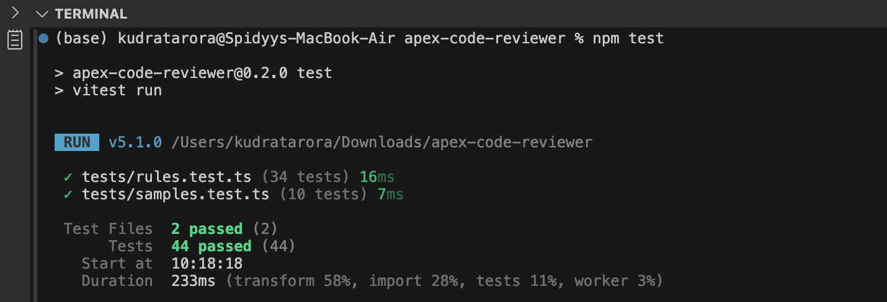

The plugin also passes Claude Code's own validator (`claude plugin validate .`):

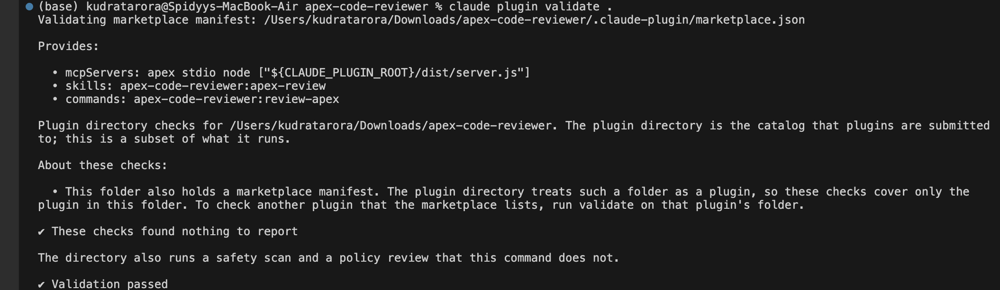

### MCP server tested on its own

I tested the MCP server outside Claude Code with the official MCP Inspector. It connects over stdio, lists the three tools with the correct read-only hints, and `scan_apex_file` returns the six expected findings for `AccountService.cls`.

| | |
|---|---|
| 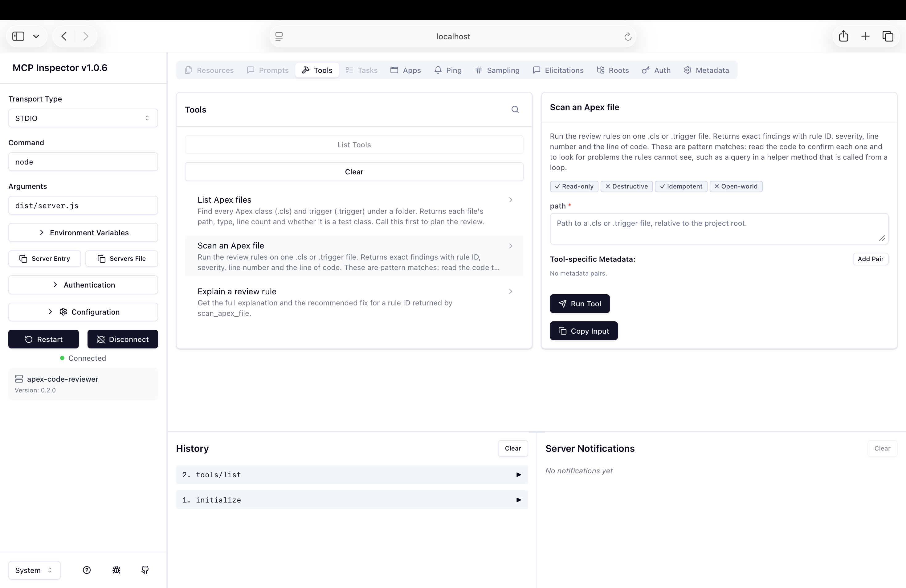 | 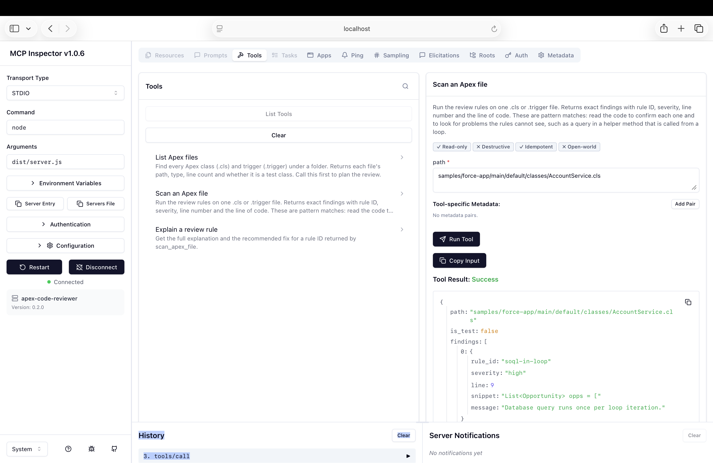 |

### Sample projects with a known answer

`samples/force-app` is a small Salesforce project with **13 planted problems** across 5 files, plus 3 clean files that should get no findings. `samples/answer-key.json` lists every problem and its line.

Twelve of the problems can be found by the rules. **One cannot:** in `CaseEscalationService.cls` the query sits in a helper method that is called from inside a loop. The rules see nothing wrong, so finding it shows whether Claude's review step adds real value.

`samples-hard/` is a harder set: longer files, **five problems the rules cannot see**, and decoys that look wrong but are safe.

### Evals

```bash
npm run eval -- --runs 3                              # with the plugin, default model
npm run eval -- --runs 3 --model haiku                # with the plugin, Claude Haiku
npm run eval -- --runs 3 --baseline                   # Claude Code without the plugin
npm run eval -- --runs 3 --model haiku --set hard     # the hard set
```

Each run copies a sample project to a temporary folder, runs Claude Code headless and scores the `apex-review.json` it writes against the answer key. The baseline gets the same rule list and output format in its prompt, but no tools, skill or method, so the comparison shows what the plugin adds. Every score and every report Claude wrote are saved in `evals/results/`, with an index in [evals/results/README.md](evals/results/README.md).

### Results

All runs used my Claude Code subscription login, so they were not charged per token. "API cost" is what each run would cost on the Claude API.

**Basic set** (`samples/`, 13 problems, 3 runs each): every setup found all 13 problems in every run. Claude Haiku without the plugin made one false alarm (it flagged a test class for missing sharing). With the plugin, Haiku made none. This set turned out to be too easy to separate the setups, so I built a harder one.

**Hard set** (`samples-hard/`, 13 problems, 3 runs each):

| Setup | Problems found | False alarms | Avg time | API cost per run |
|---|---|---|---|---|
| Haiku, no plugin | 12, 12, 13 | 1, 0, 1 | 96 s | US$0.02 |
| Haiku, plugin v1 | 12, 12, 13 | 0, 1, 1 | 102 s | US$0.02 |
| **Haiku, plugin v2** | **13, 13, 13** | **0, 1, 0** | 121 s | **US$0.02** |
| Opus, no plugin | 13, 13, 13 | 0, 0, 0 | 77 s | US$0.39 |
| Opus, plugin v1 | 13, 13, 13 | 0, 0, 0 | 123 s | US$0.55 |
| Opus, plugin v2 | 13, 13, 13 | 0, 0, 0 | 114 s | US$0.55 |

I later repeated one Haiku run on the hard set with and without the plugin to record it. With the plugin, Haiku found all 13 problems. Without it, Haiku found 12 and missed a hardcoded ID, the same pattern as in the table.

| | |
|---|---|
| 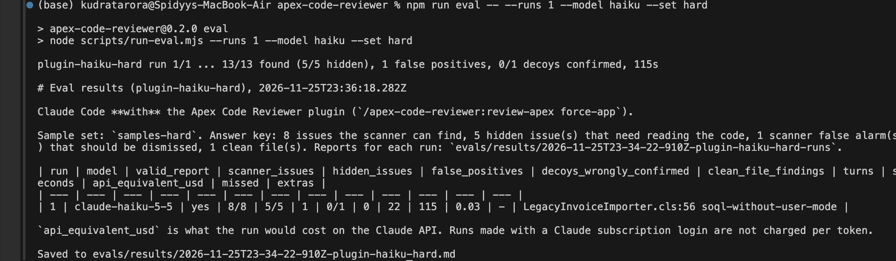 | 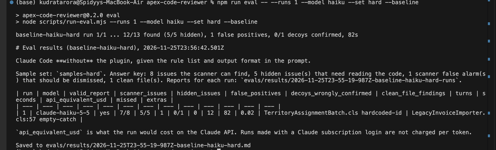 |

What I changed and why:

- **Answer key fixes.** In the first hard round, Claude reported two problems that my answer key had marked as safe. Both were real. `String.escapeSingleQuotes` does not protect a table name joined into a query, and a dynamic `Database.query` without `AccessLevel.USER_MODE` runs in system mode. I corrected the key and re-scored the saved reports instead of running them again. The original scores are kept in `evals/results/answer-key-v1/`.
- **v1 to v2.** With v1, Haiku never missed a problem the rules cover, but in two of three runs it missed the dynamic query problem that the rules did not cover. It seemed to rely on the scanner's list. Without the plugin, Haiku had the opposite problem and missed a hardcoded ID in two of three runs. For v2 I extended the `soql-without-user-mode` rule to dynamic queries and let it accept an explicit `WITH SYSTEM_MODE`. I also told the skill that the scanner's list is a starting point, not the whole review, and that a documented empty catch is intended.

What the results show:

- **With v2, Claude Haiku plus the plugin matched Claude Opus** on both sets, at about one twenty-fifth of the API cost per review.
- **Opus does not need the plugin to find these problems.** For Opus, the plugin adds consistency (the same rules, exact line numbers and the same report format every time) and makes each review about 40 seconds slower.
- **Run variation matters.** A single run can hide problems. Running each setup three times showed misses that one run would have hidden.

## Evidence

All 34 screenshots are in [evidence/screenshots/](evidence/screenshots/).

| Screenshots | What they show |
|---|---|
| 01 to 04 | Unit tests, build, plugin validation and the scanner on its own |
| 05 to 10 | The plugin loaded in Claude Code: the MCP server connected and its three tools |
| 11 to 13 | A live review: skill loaded, report files written and the final summary |
| 14 to 17 | The review report Claude wrote |
| 18 to 20 | Eval runs with and without the plugin, and the results table |
| 21 to 26 | The MCP server tested on its own in the MCP Inspector |
| 27 to 33 | The plugin installed from GitHub in a fresh project, then a full review |
| 34 | The public GitHub repository |

## Project structure

| Path | What it is |
|---|---|
| `.claude-plugin/` | Plugin manifest, marketplace file and icon |
| `.mcp.json` | Starts the MCP server when the plugin loads |
| `src/` | MCP server, rules and Apex reader (TypeScript) |
| `dist/server.js` | Bundled MCP server that the plugin runs (built with `npm run build`) |
| `skills/apex-review/` | The skill and its rules reference |
| `commands/` | The slash command |
| `samples/`, `samples-hard/` | Sample Salesforce projects and their answer keys |
| `tests/` | Unit tests |
| `scripts/` | Eval runner, rules reference generator and a sample scan script |
| `evals/results/` | Saved eval results and the report from every run |
| `examples/` | Example review output |
| `evidence/` | Screenshots and the output of a live review |

## Development

```bash
npm install
npm run build    # type-check and bundle the MCP server to dist/server.js
npm run docs     # regenerate the rules reference from src/rules.ts
npm test         # unit tests
claude plugin validate .
```

### Adding a rule

1. Add an entry to the `RULES` list in `src/rules.ts` with an `id`, `title`, `severity`, `category`, `why`, `fix` and a `check` function. The check receives the prepared file (see [How the scanner reads Apex](#how-the-scanner-reads-apex)) and returns the character offset and a message for each match. Use `src.code` so comments and strings are ignored, and `src.inLoop` to test whether a match sits inside a loop.
2. Add good and bad examples to `tests/rules.test.ts` and run `npm test`.
3. Run `npm run docs` to regenerate `skills/apex-review/references/rules.md`.
4. Add the rule to the table in `skills/apex-review/SKILL.md` so Claude can use the new rule ID.
5. Run `npm run build`, then `claude plugin validate .`.
6. If the rule should be part of the evals, add the problem to a sample project and its answer key, then run the evals again.

## Version history

| Version | Changes |
|---|---|
| 0.1.0 | First version: nine rules, the MCP server with three tools, the review skill and the slash command. Tested on the basic sample set. |
| 0.2.0 | After the hard set evals: `soql-without-user-mode` now also checks dynamic queries and accepts `WITH SYSTEM_MODE`. The skill treats the scanner's list as a starting point and accepts a documented empty catch. The tools declare full safety hints. I added the MIT licence and the plugin icon. |

## Limitations

- **Pattern rules, not a compiler.** The rules read Apex with patterns rather than a full parser, so unusual code layouts can be missed. Claude's review step is there to catch what the patterns cannot see.
- **Synthetic test code.** The sample projects were written for testing. The plugin has not been run on real client code.
- **Small test sets and a revised answer key.** Two sample sets with 13 problems each and three runs per setup is a small sample. I corrected the hard answer key twice: once when Claude found real problems I had missed, and once when the v2 rule change moved a problem from "hidden" to "scanner". Both changes are recorded in `samples-hard/answer-key.json`.
- **Slower reviews.** The plugin makes each review slower, because Claude scans and then reads every file.
- **Nine rules.** Salesforce's own static analysis tools (PMD and Code Analyzer) have many more rules. This prototype focuses on the problems that most often fail in production, and adds explanations and fixes on top.

## Licence

MIT. See [LICENSE](LICENSE).
